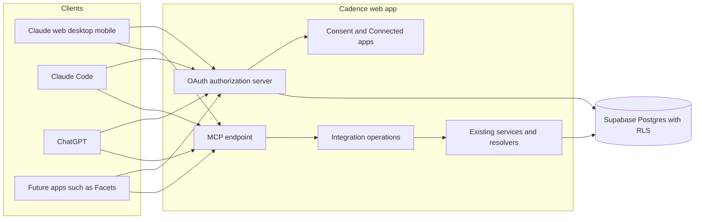

# Cadence MCP server integration brief

Status: local foundations implemented; endpoints and client acceptance remain
planned. The owner approved the direction on 2026-10-18; Tickets 220–232
implement it. `STATUS.md` holds the current implementation state. Decisions and
superseded lines are in `docs/DECISIONS.md` ("2026-10-18: Cadence MCP server and
AI plugins"). The operation contract (tool names, schemas, scopes, error codes,
limits, versioning) is `docs/MCP_CONTRACT.md`, written by Ticket 221. This brief
follows the template in `docs/INTEGRATION_PLAYBOOK.md`.

Tickets 220, 221, and 223 passed independent wave-1 verification. Ticket 222's
retry-storage correction awaits independent re-verification. The operation
contract, persistence, and RLS request context exist locally. OAuth endpoints,
operation handlers, consent UI, and MCP transport do not exist yet. Sections
below describe the intended full integration; section 11 records proven scope.

## 1. Outcome and boundary

- **User benefit:** A Cadence user connects Claude or ChatGPT to their account.
  The AI client can read all of the user's tracking data and, after the user
  confirms in the client, mark Occurrences, edit Occurrence notes, and create,
  edit, archive, or restore Behaviors.
- **Data direction:** Both. Outbound: tracking data from Cadence to the AI client
  the user connected. Inbound: the scoped writes listed below.
- **Account mapping:** The Supabase user ID owns all data. Each grant binds one
  Cadence user to one OAuth client. The client sees the account only as a
  per-client pairwise identifier, never the Supabase user ID or the email
  address. One grant serves exactly one Cadence account.
- **Source of truth:** Cadence owns Behaviors, Occurrences, statuses, status
  history, notes, and analytics. Cadence's private OAuth schema (Ticket 222) owns
  clients, grants, codes, token hashes, idempotency records, external references,
  and integration activity. The AI client owns its own conversation and any copy
  of returned data.
- **Read authority (`cadence.read`, required):** Behaviors including archived,
  schedules and time entries, categories, Occurrences, statuses, status history,
  Occurrence notes, archive notes, time sessions, adherence analytics,
  per-Behavior reminder settings, and the profile timezone. Reads are bounded by
  the date-range and page limits in `docs/MCP_CONTRACT.md`.
- **Write authority:** two separate optional scopes.
  - `cadence.occurrences.write`: set an Occurrence's status (Completed, Not
    Completed, or back to Unresolved) and add or edit its note.
  - `cadence.behaviors.write`: create a Behavior, edit its name, description,
    category, schedules, times, and reminders, and archive or restore it.
  - No deletes. No category, settings, timezone, or account changes.
- **Onward disclosure:** Connecting an AI client is a disclosure to that client's
  provider (Anthropic or OpenAI) at the user's direction. It is separate from any
  inbound connector grant. The Google Calendar grant never authorizes MCP
  disclosure, so Calendar data is excluded. The Daily Brief model-data consent
  does not authorize MCP disclosure either. Disconnecting in Settings → Connected
  apps revokes the grant on the next request. Data the client already received
  stays with that client's provider under its own terms; Ticket 231 discloses this.
- **Explicit exclusions:** Google Calendar events and connection state; travel
  settings, routes, and device location; Daily Brief text and preferences;
  reminder delivery logs; push subscriptions; import-run internals; credentials
  and tokens; the email address. Also excluded: deletes, server-side AI or
  autonomous execution, natural-language recurrence parsing on the server,
  medication doses, amounts, refills, or inventory, and MCP Apps widgets.

## 2. Architecture

One request:

1. The client calls `/mcp` without a token and gets 401 with
   `WWW-Authenticate: Bearer resource_metadata=".../.well-known/oauth-protected-resource/mcp"`.
2. The client reads protected-resource and authorization-server metadata,
   identifies itself (CIMD, or DCR as a fallback), and starts an authorization
   code flow with PKCE S256 and `resource`.
3. The user signs in with Google as today and approves on Cadence's consent
   screen. Read is required; each write scope can be switched off.
4. Cadence issues an opaque access token (about 1 hour) and a rotating refresh
   token. Both are bound to the MCP URL and stored only as SHA-256 hashes.
5. Each tool call runs: token check → grant still active → scope check → per-grant
   rate limit → integration operation → existing service → database as that user
   under RLS (through an internal token of at most 5 minutes that never leaves the
   server) → activity record.

Layer ownership is registered in `docs/AGENT_RESOLVERS.md` ("Integration
operations ownership"). The integration operations layer is one transport
adapter over one contract. It is not a connector SDK or provider registry.

## 3. Platform impact

| Platform | Implementation, follow-up, or not-applicable reason |
|---|---|
| Web | Local foundations: contract (221), private persistence (222; retry correction awaiting review), request context (223). Planned: OAuth server and discovery (226), read and write operations (224–225), consent screen and Settings → Connected apps (227), `/mcp` (228), legal drafts and the OpenAI challenge route (231), staging acceptance (232). Routes: `docs/ROUTE_MAP.md`. Interactions are registered when Ticket 227 implements them. |
| Desktop | No desktop code in v1. Linked desktop receives MCP-made changes through existing account sync, because writes reuse the web app's write paths and synced tables do not change. Account-free desktop data never reaches the server, so MCP cannot read it. A local stdio MCP server is a follow-up in `docs/FUTURE_UPDATES.md`. Ticket 227 records the desktop decision in `docs/DESKTOP_PARITY.md`. |
| Marketing | Planned: `/developers` docs section in `apps/marketing` (Ticket 229), plugin listing links, and disclosures after owner approval (231). No public claim before deployed evidence. |
| Future mobile | Not applicable. A future client can reuse `docs/MCP_CONTRACT.md`. |

## 4. Capability research (dated 2026-10-18)

Label for every row: **Documented support**. Ticket 220 re-read the first three
sources on 2026-10-18. The other rows come from the Spec's research list (fetched
2026-10-18 by the coordinator) and are not re-read here. None of this proves
Cadence implements the behavior or that a client accepts it.

| Topic | Requirement | Source |
|---|---|---|
| MCP spec version | Target MCP 2026-07-28 while staying compatible with older versions that Claude and ChatGPT negotiate. Ticket 228 records accepted versions. | [MCP 2026-07-28 changelog](https://modelcontextprotocol.io/specification/2026-07-28/changelog), [release post](https://blog.modelcontextprotocol.io/posts/2026-07-28/) |
| Protected resource metadata | MCP servers MUST implement RFC 9728. Unauthenticated requests get 401; invalid or expired tokens MUST get 401. | [MCP authorization](https://modelcontextprotocol.io/specification/2026-07-28/basic/authorization) |
| Audience binding | Clients MUST send RFC 8707 `resource` in authorization and token requests. Servers MUST validate that tokens were issued for them and MUST NOT accept or pass through other tokens. | MCP authorization |
| Client registration | Authorization servers SHOULD support Client ID Metadata Documents. Dynamic Client Registration (RFC 7591) MAY be supported and is deprecated, kept for compatibility. | MCP authorization |
| Issuer identification | Authorization servers SHOULD return `iss` in every authorization response, including errors, and then MUST advertise `authorization_response_iss_parameter_supported: true` (RFC 9207). | MCP authorization |
| Scopes and step-up | Servers SHOULD put `scope` in `WWW-Authenticate`. Insufficient scope SHOULD return 403 with `error="insufficient_scope"`, the required scopes, and `resource_metadata`. `offline_access` SHOULD NOT appear in protected-resource `scopes_supported`. | MCP authorization |
| Tokens in URLs | Access tokens MUST NOT appear in the query string; `Authorization: Bearer` on every request. | MCP authorization |
| Claude discovery | Claude needs a 401 (it ignores `WWW-Authenticate` on 200), uses only the first `authorization_servers` entry, and requires `resource` to equal the MCP URL exactly. | [Claude connector authentication](https://claude.com/docs/connectors/building/authentication) |
| Claude CIMD | Claude uses CIMD only when metadata advertises `client_id_metadata_document_supported: true` and `none` in `token_endpoint_auth_methods_supported`; otherwise it falls back to DCR. DCR registers a new client on every fresh connection. | Claude connector authentication |
| Claude callbacks | Hosted Claude apps use `https://claude.ai/api/mcp/auth_callback`. Claude Code uses a loopback redirect on an ephemeral port; match `http://localhost/callback` and `http://127.0.0.1/callback` ignoring the port. Its CIMD is `https://claude.ai/oauth/claude-code-client-metadata`. Show the redirect host on consent. | Claude connector authentication |
| Claude token endpoint | PKCE S256 on every request. Form-urlencoded token requests. Bad refresh tokens return `invalid_grant`. Rotate refresh tokens for public clients. Claude appends `offline_access` when the authorization server lists it. Limits: 10 seconds for discovery, registration, and token; 30 seconds for refresh. | Claude connector authentication |
| ChatGPT redirect | Default `https://chatgpt.com/connector/oauth/{callback_id}`; the stable `https://chatgpt.com/connector_platform_oauth_redirect` applies when the server returns `iss` per RFC 9207 with a consistent issuer. | [OpenAI plugin authentication](https://developers.openai.com/plugins/build/auth) |
| ChatGPT registration and PKCE | CIMD preferred; DCR supported and reused per connection. Metadata must list `S256`. Tokens should carry `resource` as audience. | OpenAI plugin authentication |
| ChatGPT tool auth | Per-tool `securitySchemes` (`oauth2` with scopes). The linking UI also needs an error result with `_meta["mcp/www_authenticate"]`. Declarations never replace server enforcement. | OpenAI plugin authentication |
| ChatGPT workspace domain restriction | Enterprise domain restriction needs OIDC discovery, `openid` and `email` scopes, and a UserInfo email. Not in v1 scope; the email address stays excluded. | OpenAI plugin authentication |
| Directory review | Tool annotations, titles, no model-instruction text in descriptions, test account, privacy and support URLs. Ticket 231 re-reads these before the packet. | [Claude submission](https://claude.com/docs/connectors/building/submission), [Claude review criteria](https://claude.com/docs/connectors/building/review-criteria), [OpenAI MCP server](https://developers.openai.com/plugins/build/mcp-server), [OpenAI submission](https://developers.openai.com/plugins/deploy/submission) |
| Supabase signing keys | Cadence mints a short-lived ES256 user token with an imported signing key so RLS applies. Hosted plan support is an assumption that Tickets 223 and 232 verify. | [Supabase signing keys](https://supabase.com/docs/guides/auth/signing-keys) |
| Supabase OAuth server (rejected) | Its OAuth tokens are standard `authenticated` JWTs; scopes control OIDC data only. See `docs/qa/advisor-auth-isolation.md`. | [Supabase OAuth token security](https://supabase.com/docs/guides/auth/oauth-server/token-security) |

Missing-value meanings, field types, pagination, limits, and stable error codes
are owned by `docs/MCP_CONTRACT.md` (Ticket 221). Rules that apply there: Needs
decision is derived, never stored; adherence excludes Unresolved; no streaks;
`local_date` plus IANA timezone plus UTC instants; over-limit requests fail with
a stable error instead of truncating.

## 5. Contract and ownership

| Concern | Owner |
|---|---|
| Tool names, input and output JSON Schemas, scopes, annotations, error codes, limits, contract version `1.0.0` | `packages/core/src/integration/` and `docs/MCP_CONTRACT.md` (Ticket 221) |
| OAuth clients, codes, grants, token hashes, activity, idempotency, external references | Private schema and `lib/db/` repositories (Ticket 222) |
| Acting as the user under RLS | `lib/integrations/request-context.ts` (Ticket 223) |
| Domain reads and writes | Integration operations calling existing services (Tickets 224–225) |
| OAuth protocol and token verification | `/oauth/*`, `.well-known` routes (Ticket 226) |
| Consent and Connected apps UI | Ticket 227 |
| MCP transport, tool registration, output validation | `app/mcp/route.ts`, `lib/mcp/` (Ticket 228) |

Write safety: optional `idempotency_key` on every write (24-hour replay; a reused
key with a different payload fails), `expected_status` and `expected_revision`
concurrency checks, and the same database functions the web app uses. Write
annotations make Claude and ChatGPT ask the user before running them.

Provenance: MCP status marks use existing vocabularies (explicit-user semantics,
capture method `manual_text`; assumption pending owner confirmation). Hosted
integration activity records which client made each write. Synced tables do not
change, so desktop needs no migration. Per-event client provenance in synced
history and BehaviorLog is a follow-up.

Facets foundations (owner decision 3): client attribution, retry-safe writes,
`external_ref` on create, and `updated_since` reads. Cadence records Completed and
Not Completed adherence only; doses, amounts, refills, and medication metadata
stay outside Cadence.

## 6. Security and lifecycle

Credential custody:

- Access and refresh tokens are opaque random values. Only SHA-256 hashes are
  stored. Tokens never appear in URLs, logs, exports, or BehaviorLog.
- The internal user token is minted per request, lives at most 5 minutes, never
  leaves the server, and is never logged. The signing key is a server-only
  environment variable (Ticket 223).
- The service role is limited to token-endpoint functions. It never reads or
  writes user tracking data.
- User-entered text (titles, notes) is returned as data. Tool descriptions carry
  no instructions to the model.

| Transition | Decision |
|---|---|
| Connect | Signed-in consent screen; exact or loopback redirect match; PKCE S256; `resource` must equal the MCP URL; single-use code valid at most 10 minutes; `iss` in every response. The grant and code are created atomically at consent. |
| Cancel | Deny returns `access_denied` with `iss`. No grant, code, or tracking record changes. |
| Refresh | Rotation on every refresh. Reuse of an old refresh token revokes the whole token family. Bad tokens get `invalid_grant`. |
| Reconnect | A new consent creates a new grant. Revoked grants stay revoked; their tokens fail on the next request. |
| Disconnect | Settings → Connected apps revokes the grant and every token at once. The next MCP call fails with 401. RFC 7009 revocation from the client has the same effect. |
| Account switch | Not applicable: each grant binds one Cadence user. Signing in as another user on the consent screen creates a grant for that user only. |
| Account deletion | Deletes all grants, tokens, codes, idempotency records, external references, and activity with the account (Ticket 222). |
| Export/backup | OAuth and activity tables are excluded from Cadence exports, BehaviorLog, and desktop sync. |

Other controls: per-grant read and write rate limits, a rate-limited registration
endpoint, SSRF-protected CIMD fetches, privacy-safe monitoring, a server-only
kill switch for `/mcp`, `/oauth/*`, and discovery, and an incident function that
revokes every grant. Integration activity keeps no free-text payloads and is
retained 90 days.

## 7. Smallest end-to-end slice

Discovery → OAuth (CIMD and DCR paths) → consent with one write scope switched off
→ `tools/list` → one read tool → one write tool with idempotent replay → missing
scope returns 403 → Disconnect → next call returns 401. Ticket 228 proves it
locally with MCP Inspector on `next dev` and a second isolated user. Ticket 232
repeats it on staging with Claude, Claude Code, ChatGPT developer mode, and MCP
Inspector, plus a linked desktop that shows an MCP-made change after sync.

## 8. Release, rollback, and cleanup

- Release dependencies: hosted migration push, signing-key import, Vercel
  environment variables, deployment, owner-approved Privacy and Terms, OpenAI
  organization verification and domain challenge, directory submissions, and a
  reviewer sign-in decision. All are owner-only.
- Rollback: the kill switch disables `/mcp`, `/oauth/*`, and discovery without a
  deploy; the incident function revokes every grant; Vercel instant rollback
  restores the prior deployment; migrations only add a private schema and new
  objects (disable, then a forward migration removes them if needed); listings
  can be delisted in each portal.
- Cleanup (Ticket 232): revoke test grants, delete test data and accounts, and
  read back the cleanup. Keys, tokens, and provider payloads stay outside git.

## 9. Owner-only actions

- Approve the Privacy and Terms changes (Ticket 231).
- Authorize the hosted migration push, signing-key import, Vercel environment
  variables, and deployments (Ticket 232).
- Complete OpenAI organization verification and submit the ChatGPT plugin.
- Submit the connector and plugin in Claude's developer portal.
- Decide how directory reviewers sign in.
- Confirm the open assumptions below.

## 10. Open assumptions

| Assumption | Status |
|---|---|
| "Plugin" means a Claude plugin (skills plus MCP config from GitHub) and a ChatGPT plugin with MCP, both pointing at one server. | Owner to confirm |
| MCP URL `https://app.cadence-me.com/mcp`; OAuth issuer `https://app.cadence-me.com`. | Owner to confirm |
| MCP status marks use explicit-user semantics with capture method `manual_text`; hosted activity records the client; synced tables do not change. | Owner to confirm |
| Directory listings disclose that Cadence may hold personal health data. | Owner to confirm |
| The hosted Supabase plan allows importing a signing key. | Tickets 223 and 232 verify |

## 11. Evidence ledger

Keep evidence classes separate, as the playbook requires. Later tickets append
rows; do not rewrite earlier rows.

| Evidence class | Planning checkpoint (Ticket 220, 2026-10-18) |
|---|---|
| Documented support | Section 4. |
| Source check | None yet. |
| Fixture or contract check | None yet; Ticket 221 adds contract fixtures. |
| Native runtime | Not applicable in v1 except the linked-desktop sync check in Ticket 232. |
| Live provider | None yet; Ticket 232. |
| Deployed behavior | None yet; Ticket 232. |
| Public approval | None yet; owner submissions after Ticket 231. |

| Evidence class | Wave-1 checkpoint (2026-10-18) |
|---|---|
| Source check | Independent verification approved Tickets 220, 221, and 223 at `b13eeb3617ae780ce59fb4c4d13640f30a4041bf`. Contract: `packages/core/src/integration/`. Private persistence: `lib/db/oauth.repo.ts`, `lib/db/integration.repo.ts`, Ticket 222 migrations. User-scoped context: `lib/integrations/request-context.ts`. No HTTP integration endpoints yet. |
| Fixture or contract check | `tests/integration-contract.test.ts` verifies 16 tools, schemas, exclusions, limits, and generated documentation. `tests/sql/ticket-222-oauth-persistence-smoke.sql` verifies OAuth lifecycle and isolation. `tests/integration-request-context.local-integration.test.ts` verifies minted tokens with two isolated users. |
| Fixture or contract check | Ticket 222 correction: `tests/integration-idempotency.local-integration.test.ts` validates large outputs and exercises real begin/complete/replay RPCs, preserving long notes. A forward migration permits 512 KiB of JSONB text while the wire cap remains 100,000 bytes; rationale in `DATA_MODEL.md`. An isolated clean reset (82 migrations), SQL smoke, and 232 focused contract/repository/RLS tests passed. A 99,948-byte Behavior response occupies 297,181 JSONB text bytes, proving 256 KiB insufficient. Independent correction review remains pending. |
| Fixture or contract check | The existing `smoke:rls` fixture fails before assertions with “Configuration event plan does not match behavior state.” The verifier reproduced it on base `041546ed573af042cf6a7fb4ed9ce832696ca539`; its creation snapshot omits `location_text`. This correction does not change that fixture. |
| Deployed behavior | No hosted migration push or deployment is reported for Tickets 220–223. Hosted state was not queried during the correction. Signing-key import, staging, live clients, and deployment acceptance remain owner-gated in Ticket 232. Wave 2 remains on hold pending independent re-verification. |
