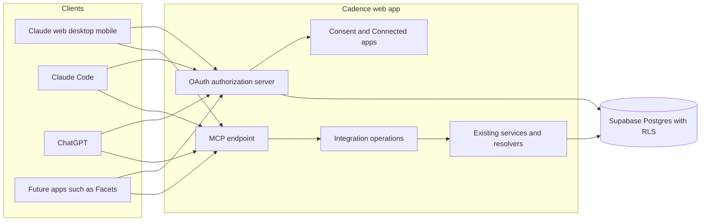

# Cadence MCP server integration brief

Status: the operation contract, persistence, scoped operations, OAuth endpoints,
consent UI, Connected apps and MCP transport are implemented locally. Hosted
deployment and live client acceptance remain pending. The owner approved the direction on 2026-10-18; Tickets 220–232
implement it. `STATUS.md` holds the current implementation state. Decisions and
superseded lines are in `docs/DECISIONS.md` ("2026-10-18: Cadence MCP server and
AI plugins"). The operation contract (tool names, schemas, scopes, error codes,
limits, versioning) is `docs/MCP_CONTRACT.md`, written by Ticket 221. This brief
follows the template in `docs/INTEGRATION_PLAYBOOK.md`.

Tickets 220–228 passed independent verification at
`99488a9a9a0d05fe70b5f18b60b3d093bf1e1eaf`, including the retry-storage correction.
Wave 4 adds developer documentation, plugin packages, and unpublished legal
drafts. Historical checkpoints below retain their original evidence boundaries;
they do not describe the current implementation state.

## 1. Outcome and boundary

- **User benefit:** A Cadence user connects Claude or ChatGPT to their account.
  The AI client can read all of the user's tracking data and, after the user
  confirms in the client, mark Occurrences, edit Occurrence notes, and create,
  edit, archive, or restore Behaviors.
- **Data direction:** Both. Outbound: tracking data from Cadence to the AI client
  the user connected. Inbound: the scoped writes listed below.
- **Account mapping:** The Supabase user ID owns all data. Each grant binds one
  Cadence user to one OAuth client. The client sees the account only as a
  per-client pairwise identifier, never the Supabase user ID or the email
  address. One grant serves exactly one Cadence account.
- **Source of truth:** Cadence owns Behaviors, Occurrences, statuses, status
  history, notes, and analytics. Cadence's private OAuth schema (Ticket 222) owns
  clients, grants, codes, token hashes, idempotency records, external references,
  and integration activity. The AI client owns its own conversation and any copy
  of returned data.
- **Read authority (`cadence.read`, required):** Behaviors including archived,
  schedules and time entries, categories, Occurrences, statuses, status history,
  Occurrence notes, archive notes, time sessions, adherence analytics,
  per-Behavior reminder settings, and the profile timezone. Reads are bounded by
  the date-range and page limits in `docs/MCP_CONTRACT.md`.
- **Write authority:** two separate optional scopes.
  - `cadence.occurrences.write`: set an Occurrence's status (Completed, Not
    Completed, or back to Unresolved) and add or edit its note.
  - `cadence.behaviors.write`: create a Behavior, edit its name, description,
    category, schedules, times, and reminders, and archive or restore it.
  - No deletes. No category, settings, timezone, or account changes.
- **Onward disclosure:** Connecting an AI client is a disclosure to that client's
  provider (Anthropic or OpenAI) at the user's direction. It is separate from any
  inbound connector grant. The Google Calendar grant never authorizes MCP
  disclosure, so Calendar data is excluded. The Daily Brief model-data consent
  does not authorize MCP disclosure either. Disconnecting in Settings → Connected
  apps revokes the grant on the next request. Data the client already received
  stays with that client's provider under its own terms; Ticket 231 discloses this.
- **Explicit exclusions:** Google Calendar events and connection state; travel
  settings, routes, and device location; Daily Brief text and preferences;
  reminder delivery logs; push subscriptions; import-run internals; credentials
  and tokens; the email address. Also excluded: deletes, server-side AI or
  autonomous execution, natural-language recurrence parsing on the server,
  medication doses, amounts, refills, or inventory, and MCP Apps widgets.

## 2. Architecture



One request:

1. The client calls `/mcp` without a token and gets 401 with
   `WWW-Authenticate: Bearer resource_metadata=".../.well-known/oauth-protected-resource/mcp"`.
2. The client reads protected-resource and authorization-server metadata,
   identifies itself (CIMD, or DCR as a fallback), and starts an authorization
   code flow with PKCE S256 and `resource`.
3. The user signs in with Google as today and approves on Cadence's consent
   screen. Read is required; each write scope can be switched off.
4. Cadence issues an opaque access token (about 1 hour) and a rotating refresh
   token. Both are bound to the MCP URL and stored only as SHA-256 hashes.
5. Each tool call runs: token check → grant still active → scope check → per-grant
   rate limit → integration operation → existing service → database as that user
   under RLS (through an internal token of at most 5 minutes that never leaves the
   server) → activity record.

Layer ownership is registered in `docs/AGENT_RESOLVERS.md` ("Integration
operations ownership"). The integration operations layer is one transport
adapter over one contract. It is not a connector SDK or provider registry.

## 3. Platform impact

| Platform | Implementation, follow-up, or not-applicable reason |
|---|---|
| Web | Locally implemented and independently verified: contract (221), private persistence (222), request context (223), read/write operations (224–225), OAuth/discovery (226), consent and Settings → Connected apps (227), and `/mcp` transport (228; `docs/qa/mcp-server.md`). Ticket 231 owns legal drafts and the OpenAI challenge route; Ticket 232 owns hosted/client acceptance. Routes: `docs/ROUTE_MAP.md`; implemented interactions: `interaction-registry.json`. |
| Desktop | No desktop code in v1. Linked desktop receives MCP-made changes through existing account sync, because writes reuse the web app's write paths and synced tables do not change. Account-free desktop data never reaches the server, so MCP cannot read it. A local stdio MCP server is a follow-up in `docs/FUTURE_UPDATES.md`. Ticket 227 records the desktop decision in `docs/DESKTOP_PARITY.md`. |
| Marketing | Planned: `/developers` docs section in `apps/marketing` (Ticket 229), plugin listing links, and disclosures after owner approval (231). No public claim before deployed evidence. |
| Future mobile | Not applicable. A future client can reuse `docs/MCP_CONTRACT.md`. |

## 4. Capability research (dated 2026-10-18)

Label for every row: **Documented support**. Ticket 220 re-read the first three
sources on 2026-10-18. The other rows come from the Spec's research list (fetched
2026-10-18 by the coordinator) and are not re-read here. None of this proves
Cadence implements the behavior or that a client accepts it.

| Topic | Requirement | Source |
|---|---|---|
| MCP spec version | Target MCP 2026-07-28 while staying compatible with older versions that Claude and ChatGPT negotiate. Ticket 228 records accepted versions. | [MCP 2026-07-28 changelog](https://modelcontextprotocol.io/specification/2026-07-28/changelog), [release post](https://blog.modelcontextprotocol.io/posts/2026-07-28/) |
| Protected resource metadata | MCP servers MUST implement RFC 9728. Unauthenticated requests get 401; invalid or expired tokens MUST get 401. | [MCP authorization](https://modelcontextprotocol.io/specification/2026-07-28/basic/authorization) |
| Audience binding | Clients MUST send RFC 8707 `resource` in authorization and token requests. Servers MUST validate that tokens were issued for them and MUST NOT accept or pass through other tokens. | MCP authorization |
| Client registration | Authorization servers SHOULD support Client ID Metadata Documents. Dynamic Client Registration (RFC 7591) MAY be supported and is deprecated, kept for compatibility. | MCP authorization |
| Issuer identification | Authorization servers SHOULD return `iss` in every authorization response, including errors, and then MUST advertise `authorization_response_iss_parameter_supported: true` (RFC 9207). | MCP authorization |
| Scopes and step-up | Servers SHOULD put `scope` in `WWW-Authenticate`. Insufficient scope SHOULD return 403 with `error="insufficient_scope"`, the required scopes, and `resource_metadata`. `offline_access` SHOULD NOT appear in protected-resource `scopes_supported`. | MCP authorization |
| Client scope selection | Challenged scopes are authoritative and required for the current request. At link time clients use the `scope` in the initial 401 `WWW-Authenticate` when present, else all PRM `scopes_supported`. On step-up they SHOULD request the union of earlier scopes and the challenged ones. Read 2026-10-30. | [MCP 2026-07-28 authorization](https://modelcontextprotocol.io/specification/2026-07-28/basic/authorization#scope-selection-strategy) |
| Tokens in URLs | Access tokens MUST NOT appear in the query string; `Authorization: Bearer` on every request. | MCP authorization |
| Claude discovery | Claude needs a 401 (it ignores `WWW-Authenticate` on 200), uses only the first `authorization_servers` entry, and requires `resource` to equal the MCP URL exactly. | [Claude connector authentication](https://claude.com/docs/connectors/building/authentication) |
| Claude CIMD | Claude uses CIMD only when metadata advertises `client_id_metadata_document_supported: true` and `none` in `token_endpoint_auth_methods_supported`; otherwise it falls back to DCR. DCR registers a new client on every fresh connection. | Claude connector authentication |
| Claude callbacks | Hosted Claude apps use `https://claude.ai/api/mcp/auth_callback`. Claude Code uses a loopback redirect on an ephemeral port; match `http://localhost/callback` and `http://127.0.0.1/callback` ignoring the port. Its CIMD is `https://claude.ai/oauth/claude-code-client-metadata`. Claude web's CIMD is `https://claude.ai/oauth/mcp-oauth-client-metadata`; it also lists the `urn:ietf:params:oauth:grant-type:jwt-bearer` grant, which Cadence accepts in metadata but never grants (live failure on October 29, 2026). Show the redirect host on consent. | Claude connector authentication |
| Claude token endpoint | PKCE S256 on every request. Form-urlencoded token requests. Bad refresh tokens return `invalid_grant`. Rotate refresh tokens for public clients. Claude appends `offline_access` when the authorization server lists it. Limits: 10 seconds for discovery, registration, and token; 30 seconds for refresh. | Claude connector authentication |
| ChatGPT redirect | Default `https://chatgpt.com/connector/oauth/{callback_id}`; the stable `https://chatgpt.com/connector_platform_oauth_redirect` applies when the server returns `iss` per RFC 9207 with a consistent issuer. | [OpenAI plugin authentication](https://developers.openai.com/plugins/build/auth) |
| ChatGPT registration and PKCE | CIMD preferred; DCR supported and reused per connection. Metadata must list `S256`. Tokens should carry `resource` as audience. | OpenAI plugin authentication |
| ChatGPT tool auth | Per-tool `securitySchemes` (`oauth2` with scopes). The linking UI also needs an error result with `_meta["mcp/www_authenticate"]`. Declarations never replace server enforcement. | OpenAI plugin authentication |
| ChatGPT workspace domain restriction | Enterprise domain restriction needs OIDC discovery, `openid` and `email` scopes, and a UserInfo email. Not in v1 scope; the email address stays excluded. | OpenAI plugin authentication |
| Directory review | Tool annotations, titles, no model-instruction text in descriptions, test account, privacy and support URLs. Ticket 231 re-reads these before the packet. | [Claude submission](https://claude.com/docs/connectors/building/submission), [Claude review criteria](https://claude.com/docs/connectors/building/review-criteria), [OpenAI MCP server](https://developers.openai.com/plugins/build/mcp-server), [OpenAI submission](https://developers.openai.com/plugins/deploy/submission) |
| Supabase signing keys | Cadence mints a short-lived ES256 user token with an imported signing key so RLS applies. Hosted plan support is an assumption that Tickets 223 and 232 verify. | [Supabase signing keys](https://supabase.com/docs/guides/auth/signing-keys) |
| Supabase OAuth server (rejected) | Its OAuth tokens are standard `authenticated` JWTs; scopes control OIDC data only. See `docs/qa/advisor-auth-isolation.md`. | [Supabase OAuth token security](https://supabase.com/docs/guides/auth/oauth-server/token-security) |

Missing-value meanings, field types, pagination, limits, and stable error codes
are owned by `docs/MCP_CONTRACT.md` (Ticket 221). Rules that apply there: Needs
decision is derived, never stored; adherence excludes Unresolved; no streaks;
`local_date` plus IANA timezone plus UTC instants; over-limit requests fail with
a stable error instead of truncating.

## 5. Contract and ownership

| Concern | Owner |
|---|---|
| Tool names, input and output JSON Schemas, scopes, annotations, error codes, limits, contract version `1.0.0` | `packages/core/src/integration/` and `docs/MCP_CONTRACT.md` (Ticket 221) |
| OAuth clients, codes, grants, token hashes, activity, idempotency, external references | Private schema and `lib/db/` repositories (Ticket 222) |
| Acting as the user under RLS | `lib/integrations/request-context.ts` (Ticket 223) |
| Domain reads and writes | Integration operations calling existing services (Tickets 224–225) |
| OAuth protocol and token verification | `/oauth/*`, `.well-known` routes (Ticket 226) |
| Consent and Connected apps UI | Ticket 227 |
| MCP transport, tool registration, output validation | `app/mcp/route.ts`, `lib/mcp/` (Ticket 228) |

Write safety: optional `idempotency_key` on every write (24-hour replay; a reused
key with a different payload fails), `expected_status` and `expected_revision`
concurrency checks, and the same database functions the web app uses. Write
annotations make Claude and ChatGPT ask the user before running them.

Provenance: MCP status marks use existing vocabularies (explicit-user semantics,
capture method `manual_text`; assumption pending owner confirmation). Hosted
integration activity records which client made each write. Synced tables do not
change, so desktop needs no migration. Per-event client provenance in synced
history and BehaviorLog is a follow-up.

Facets foundations (owner decision 3): client attribution, retry-safe writes,
`external_ref` on create, and `updated_since` reads. Cadence records Completed and
Not Completed adherence only; doses, amounts, refills, and medication metadata
stay outside Cadence.

## 6. Security and lifecycle

Credential custody:

- Access and refresh tokens are opaque random values. Only SHA-256 hashes are
  stored. Tokens never appear in URLs, logs, exports, or BehaviorLog.
- The internal user token is minted per request, lives at most 5 minutes, never
  leaves the server, and is never logged. The signing key is a server-only
  environment variable (Ticket 223).
- The service role is limited to token-endpoint functions. It never reads or
  writes user tracking data.
- User-entered text (titles, notes) is returned as data. Tool descriptions carry
  no instructions to the model.

| Transition | Decision |
|---|---|
| Connect | Signed-in consent screen; exact or loopback redirect match; PKCE S256; `resource` must equal the MCP URL; single-use code valid at most 10 minutes; `iss` in every response. The grant and code are created atomically at consent. |
| Cancel | Deny returns `access_denied` with `iss`. No grant, code, or tracking record changes. |
| Refresh | Rotation on every refresh. Reuse of an old refresh token revokes the whole token family. Bad tokens get `invalid_grant`. |
| Reconnect | A new consent creates a new grant. Revoked grants stay revoked; their tokens fail on the next request. |
| Disconnect | Settings → Connected apps revokes the grant and every token at once. The next MCP call fails with 401. RFC 7009 revocation from the client has the same effect. |
| Account switch | Not applicable: each grant binds one Cadence user. Signing in as another user on the consent screen creates a grant for that user only. |
| Account deletion | Deletes all grants, tokens, codes, idempotency records, external references, and activity with the account (Ticket 222). |
| Export/backup | OAuth and activity tables are excluded from Cadence exports, BehaviorLog, and desktop sync. |

Other controls: per-grant read and write rate limits, a rate-limited registration
endpoint, SSRF-protected CIMD fetches, privacy-safe monitoring, a server-only
kill switch for `/mcp`, `/oauth/*`, and discovery, and an incident function that
revokes every grant. Integration activity keeps no free-text payloads and is
retained 90 days.

## 7. Smallest end-to-end slice

Discovery → OAuth (CIMD and DCR paths) → consent with one write scope switched off
→ `tools/list` → one read tool → one write tool with idempotent replay → missing
scope returns 403 → Disconnect → next call returns 401. Ticket 228 proves it
locally with MCP Inspector on `next dev` and a second isolated user. Ticket 232
repeats it on the owner-selected production target, after execution approval,
with Claude, Claude Code, ChatGPT developer mode, and MCP
Inspector, plus a linked desktop that shows an MCP-made change after sync.

## 8. Release, rollback, and cleanup

- Disabled deployment requires a reviewed maintenance/legal candidate, Node 24
  verification, exact migration/deployment approval, runtime pairing and a
  backup/rollback plan. Approve any synthetic session checks separately.
- Public activation requires approved disclosures/data policy, working retention,
  logging privacy, signing/Auth/RLS evidence and explicit owner approval for all
  eligible users to connect. There is no synthetic-account allowlist.
- Directory publication separately requires publisher verification, reviewer
  access, domain challenge when requested, listings and submission approval.
  These are not disabled-deployment prerequisites and do not authorize activation.
- Legal text and dates belong to `components/settings/LegalContent.tsx`.
  Approve complete Privacy/Terms text there; verify public routes, Settings
  consumers and public-content tests. Do not fork text into route wrappers.
- Rollback starts with `CADENCE_MCP_ENABLED=false`, restart/redeploy and readback
  of `/mcp`, `/oauth/*` and discovery. Prefer keeping the reviewed disabled
  candidate, including maintenance and approved disclosures. The older `041546e`
  build lacks the future purge caller, restores old disclosures and returns 404
  for absent protocol routes, not the candidate's disabled 503.
  An older-code fallback requires a separately reviewed recovery build retaining
  maintenance and approved disclosures, with its own SHA, tests and approval.
  The incident function revokes all users' grants only with incident authority.
  Preserve signing-key overlap and shared SQL: migration `20261018180000` changes
  an existing status function. App rollback cannot undo it; use a reviewed forward
  migration if necessary. Never reset or automatically restore production.
- Cleanup (Ticket 232): revoke test grants, delete test data and accounts, and
  read back scoped counts. Retain shared/public client registrations. Used DCR
  and CIMD metadata has no expiry; purge is not its cleanup path. Dedicated
  test-only registrations need owner-accepted retention or separately approved,
  ID-bound cleanup proving no grants, pending requests or shared use. Keys,
  tokens, and provider payloads stay outside git.

Ticket 232 local maintenance uses the existing daily occurrence-sync route after
scheduler authentication. It awaits independent, eight-second abortable purge
work even when occurrence work fails, has no profiles, or its breaker is open.
MCP disablement does not disable retention. The repository validates all seven
raw counts before success logging. HTTP abort leaves database outcome unknown;
local/target database timeout evidence remains separate. See
`docs/OPERATIONS.md#oauth-authorization-server-ticket-226` for freshness, failure
handling and all-account effects of a manual scheduler call. No new scheduler
or schema is required by this local implementation; hosted activation remains gated.

## 9. Owner-only actions

- Approve the Privacy and Terms changes (Ticket 231).
- Authorize the hosted migration push, signing-key import, Vercel environment
  variables, and deployments (Ticket 232).
- Complete OpenAI organization verification and submit the ChatGPT plugin.
- Submit the connector and plugin in Claude's developer portal.
- Decide how directory reviewers sign in.
- Confirm the open assumptions below.

## 10. Open assumptions

| Assumption | Status |
|---|---|
| "Plugin" means a Claude plugin (skills plus MCP config from GitHub) and a ChatGPT plugin with MCP, both pointing at one server. | Owner to confirm |
| MCP URL `https://app.cadence-me.com/mcp`; OAuth issuer `https://app.cadence-me.com`. | Owner to confirm |
| MCP status marks use explicit-user semantics with capture method `manual_text`; hosted activity records the client; synced tables do not change. | Owner to confirm |
| Directory listings disclose that Cadence may hold personal health data. | Owner to confirm |
| The hosted Supabase plan allows importing a signing key. | Tickets 223 and 232 verify |

## 11. Evidence ledger

Keep evidence classes separate, as the playbook requires. Later tickets append
rows; do not rewrite earlier rows.

| Evidence class | Planning checkpoint (Ticket 220, 2026-10-18) |
|---|---|
| Documented support | Section 4. |
| Source check | None yet. |
| Fixture or contract check | None yet; Ticket 221 adds contract fixtures. |
| Native runtime | Not applicable in v1 except the linked-desktop sync check in Ticket 232. |
| Live provider | None yet; Ticket 232. |
| Deployed behavior | None yet; Ticket 232. |
| Public approval | None yet; owner submissions after Ticket 231. |

| Evidence class | Wave-1 checkpoint (2026-10-18) |
|---|---|
| Source check | Independent verification approved Tickets 220, 221, and 223 at `b13eeb3617ae780ce59fb4c4d13640f30a4041bf`. Contract: `packages/core/src/integration/`. Private persistence: `lib/db/oauth.repo.ts`, `lib/db/integration.repo.ts`, Ticket 222 migrations. User-scoped context: `lib/integrations/request-context.ts`. No HTTP integration endpoints yet. |
| Fixture or contract check | `tests/integration-contract.test.ts` verifies 16 tools, schemas, exclusions, limits, and generated documentation. `tests/sql/ticket-222-oauth-persistence-smoke.sql` verifies OAuth lifecycle and isolation. `tests/integration-request-context.local-integration.test.ts` verifies minted tokens with two isolated users. |
| Fixture or contract check | Ticket 222 correction: `tests/integration-idempotency.local-integration.test.ts` validates large outputs and exercises real begin/complete/replay RPCs, preserving long notes. A forward migration permits 512 KiB of JSONB text while the wire cap remains 100,000 bytes; rationale in `DATA_MODEL.md`. An isolated clean reset (82 migrations), SQL smoke, and 232 focused contract/repository/RLS tests passed. A 99,948-byte Behavior response occupies 297,181 JSONB text bytes, proving 256 KiB insufficient. Independent correction review remains pending. |
| Fixture or contract check | The existing `smoke:rls` fixture fails before assertions with “Configuration event plan does not match behavior state.” The verifier reproduced it on base `041546ed573af042cf6a7fb4ed9ce832696ca539`; its creation snapshot omits `location_text`. This correction does not change that fixture. |
| Deployed behavior | No hosted migration push or deployment is reported for Tickets 220–223. Hosted state was not queried during the correction. Signing-key import, staging, live clients, and deployment acceptance remain owner-gated in Ticket 232. Wave 2 remains on hold pending independent re-verification. |


## 12. OAuth implementation (Ticket 226)

`lib/services/oauth/` owns protocol validation, safe CIMD retrieval, consent
handoff and token verification. Native `.well-known` route segments publish
RFC 8414 and RFC 9728 metadata. Authorization responses include `iss`; invalid
client or redirect requests receive a local error and never redirect. All code
requests require S256 and the exact resource. The issuer comes from trusted
server configuration, never request headers. See `OPERATIONS.md` for the kill
switch, exact lifetimes, rate limits, deadlines and deployment prerequisites.

The server accepts `offline_access` as refresh permission alongside the three
tracking scopes. Pending requests, codes and token families preserve it
separately; it never grants tracking access and never appears in protected
resource metadata. Refresh tokens remain available under the server's explicit
consent policy even when the client omits that optional scope. Token responses
report the approved tracking scopes and approved `offline_access`.

Public clients may use HTTPS CIMD URLs or RFC 7591 registration. DCR honors
`application_type`: web redirects require HTTPS; native clients may use HTTP
localhost/127.0.0.1 with port-agnostic matching. Other redirects match exactly.
Known identities use exact CIMD URLs or exclusively known callback URLs;
unknown client names remain unverified. CIMD caches expire within one hour and
refresh before new authorization. TLS connections pin approved DNS addresses
and validate every redirect target. No metadata-driven user-data request exists.

`/oauth/authorize` stores a ten-minute pending request and a hash of a browser
secret. The HttpOnly cookie carries the secret; the consent URL carries only a
request UUID. Ticket 227 uses `getOAuthConsent(request, id, userClient)` for
display and `completeOAuthConsent(request, id, scopesOrNull, userClient)` on an
explicit same-origin Allow/Deny POST. The database atomically consumes the
request and creates its grant/code under the authenticated user. Scopes can
only narrow. Render client text as text, identify unverified clients, and show
the redirect host. Preserve the cookie through the existing Google login flow.

Ticket 228 uses `verifyMcpAccessToken` to resolve a SHA-256 hash, check token
expiry, exact audience, active grant/family/client and requested scopes. The
returned `VerifiedIntegrationGrant` feeds `createIntegrationContext`; no
service-role client enters the tracking operations. SQL throttles last-used
updates to once per minute. Optional required scopes produce `insufficient_scope`
without converting a valid-but-under-scoped token into an invalid token.

Web is the only changed runtime. Desktop, marketing and future mobile code are
not applicable. Consent UI, Settings and MCP tool handling remain outside
Ticket 226. Local verification is synthetic; it is not hosted deployment or
Claude/ChatGPT acceptance.

Compatibility source check, 2026-10-18: the [Claude Code CIMD](https://claude.ai/oauth/claude-code-client-metadata)
omits `application_type` while declaring loopback redirects. Cadence infers native
only when CIMD omits that field and has a valid loopback URI; an explicit web
type still forbids HTTP redirects. The [ChatGPT CIMD](https://chatgpt.com/oauth/client.json)
prefers `private_key_jwt` but lists `none` among supported alternatives. Cadence
selects that public-client alternative; it does not claim private-key JWT support.
Focused tests preserve both observed metadata shapes.


## 13. MCP endpoint implementation (Ticket 228)

Local implementation uses pinned `@modelcontextprotocol/server@2.3.1` at runtime
and `@modelcontextprotocol/client@2.3.1` for development tests. The official stable
v2 SDK split replaces the legacy `@modelcontextprotocol/sdk` package. Its
`createMcpHandler` provides native 2026-07-28 and `legacy: "stateless"` support;
Cadence does not emulate the protocol. Official references checked 2026-10-18:
[SDK repository](https://github.com/modelcontextprotocol/typescript-sdk),
[legacy support](https://github.com/modelcontextprotocol/typescript-sdk/blob/main/docs/serving/legacy-clients.md).

Accepted versions: 2026-07-28, 2025-11-25, 2025-06-18, 2025-03-26, 2024-11-05,
and 2024-10-07. Tests negotiate each legacy version. Real authenticated tests
exercise all 16 tools in modern auto-negotiation and legacy mode. SDK v2 clients
must select `versionNegotiation: { mode: "auto" }` or explicitly pin 2026-07-28
to exercise the modern path; their default remains legacy. The SDK's exported
legacy `SUPPORTED_PROTOCOL_VERSIONS` list does not include its separate modern
transport. Modern requests use the SDK's protocol metadata and method headers;
legacy responses use SSE without sessions. GET and DELETE return authenticated
405 responses. No resumption or unsolicited server messages are supported.

`server/discover` exposes tool-only capabilities and bounded cross-tool guidance.
`tools/list` follows the contract registry order, with private `ttlMs: 300000`
cache hints. Every descriptor includes its title, description, annotations,
input/output schema and OAuth scopes in both `securitySchemes` and `_meta` for
client compatibility. Successful calls return validated `structuredContent` and
short text. Stable tool errors carry actionable messages; authentication and
scope errors also carry `_meta["mcp/www_authenticate"]`.

The optional `_meta["openai/profile"]` marker is deliberately absent. OpenAI's
strict identity-only schema conflicts with the approved `get_account_context`
output. Connections work without it, but account labels and duplicate detection
may be less reliable. A compatible profile tool is deferred in `FUTURE_UPDATES.md`.
See [OpenAI multiple-account guidance](https://developers.openai.com/plugins/build/auth#support-multiple-accounts).

Admission derives grant identity only from `verifyMcpAccessToken`. Scope checks
precede durable per-grant limits (120 reads/minute, 30 writes/minute). The existing
private OAuth client runs only the counter RPC; tracking operations use the
RLS integration context. The read handlers validate output before activity;
write handlers own precommit validation, atomic activity, and bounded retry
receipts. The transport adds neither duplicate write activity nor a postcommit
validation failure. Admission storage failures fail closed with a stable error.
HTTP 401 includes protected-resource metadata and scope; missing write scopes
return 403; exhausted grants return 429 with `Retry-After`.

**Challenge scopes (Ticket 232 follow-up, October 30, 2026).** On October 29
ChatGPT linked with `cadence.read` only and never offered the write permissions.
Likely cause: the initial 401 challenged `scope="cadence.read"`, and the MCP scope
selection strategy makes clients request a challenged set when one is present.
ChatGPT's tool `securitySchemes` and `_meta` were already correct. Challenged
scopes are required for the current request (MCP 2026-07-28; RFC 6750 §3), and the
writes are optional, so the initial and invalid-token 401 now omit `scope` and keep
`resource_metadata`. Clients then fall back to protected-resource
`scopes_supported`, which lists all three tracking scopes. Consent still lets the
user switch each write off; the owner's defaults (writes on) are unchanged. A
step-up 403 now names `cadence.read` with the missing write scope. Before, it named
only the write scope, and a client that sent exactly that set got `invalid_scope`,
because `/oauth/authorize` requires `cadence.read`. The error body's
`required_scopes` still lists only the missing scope. Server-side union of
earlier permissions on re-consent is in `docs/DATA_MODEL.md` (migration
`20261030230000`). Not verified: that ChatGPT now requests the write scopes. OpenAI's
plugin authentication page does not state ChatGPT's selection order; Ticket 256
verifies the live link after deployment.

Origins are limited to the configured issuer, `https://claude.ai` and
`https://chatgpt.com`. Development additionally permits localhost/127.0.0.1 HTTP
ports 4321–4330 for Inspector. Requests without Origin remain valid. CORS permits
Authorization and MCP headers without credentials. Body reads allow 65,536 bytes
and two seconds; operation network requests share a 45-second abort deadline,
within the route's 60-second maximum. OAuth verification retains its own bounded
timeout. All routes honor `CADENCE_MCP_ENABLED`, default off. Monitoring emits only
known operation names, status, stable error code and elapsed milliseconds; no
credentials, arguments, note text, results or backend exception messages.

Evidence and remaining acceptance limits: `docs/qa/mcp-server.md`. Platform impact:
web only; linked desktop receives changes through existing sync; marketing and
future mobile have no implementation changes. No hosted deployment is implied.

## 14. Plugin packages (Ticket 230)

Local distribution artifacts only. No package has been published, submitted,
installed into a live client, or verified against hosted Cadence. Directory
submission, legal approval, verified publisher identity and live OAuth/client
acceptance remain owner actions under Tickets 231–232. Listing links identify
existing pages; they do not claim approval of the proposed legal drafts.

### Formats and primary sources checked October 18, 2026

- Claude: [manifest reference](https://code.claude.com/docs/en/plugins-reference)
  and [marketplace guide](https://code.claude.com/docs/en/plugin-marketplaces).
  The package uses `.claude-plugin/plugin.json`, root `.mcp.json` with HTTP
  transport, and `skills/<name>/SKILL.md`. Claude discovers OAuth from the remote
  endpoint; there are no credentials or authorization headers in the package.
- OpenAI: [package format](https://developers.openai.com/plugins/build/plugins),
  [skill guidance](https://developers.openai.com/plugins/build/skills), and
  [submission requirements](https://developers.openai.com/plugins/deploy/submission).
  The portable package uses root `plugin.json`, `mcp.json`, `skills/`, and assets.
  Listing metadata sits under `extensions.com.openai.interface`. The subtitle
  is 25 characters; the package uses semantic version `1.0.0`.
  The existing square Cadence logo is bundled locally.
- OpenAI OAuth configuration is server-level
  `extensions.com.openai.auth` in `mcp.json`: CIMD preference with documented
  DCR fallback, required `cadence.read`, default requests for the two optional
  write scopes, and the exact MCP resource URL. Discovery supplies endpoints.
  The user can refuse either write permission on Cadence's consent screen.
- The pinned [Agent Plugins manifest schema](https://agent-plugins.org/schemas/1.0.0/plugin.schema.json)
  and [MCP schema](https://agent-plugins.org/schemas/1.0.0/mcp.schema.json) are
  stored unchanged in `integrations/schemas/`. The published MCP schema rejects
  server extensions, while OpenAI explicitly documents its auth extension.
  Validation therefore checks the portable MCP fields against that schema and
  separately checks the documented OpenAI extension. This is not a claim that
  the unmodified upstream MCP schema accepts the whole OpenAI configuration.

### Shared workflows and package maintenance

`integrations/skills/` is the authored source for daily-check-in, weekly-review,
and routine-setup. Both packages contain identical regular-file copies under
`skills/`; plugin loading never depends on paths outside its own directory.
When editing a shared skill, copy it into both packages in the same change.
Each skill's `agents/openai.yaml` declares the Cadence MCP dependency using
OpenAI's documented `streamable_http` transport and the same remote URL.
The validator rejects drift in instructions and dependency metadata. Tool references use inline function notation,
such as `get_account_context()`, so tests can check every named tool against
`INTEGRATION_OPERATION_NAMES`. The structured routine example also validates
against the live contract schema.

Daily check-in reads today and Needs decision, then marks only confirmed
changes using current status checks and retry keys. Weekly review makes no
writes and excludes Unresolved from adherence. Routine setup previews a
structured Behavior and requires confirmation before creation. All workflows
preserve host confirmations and treat returned text as untrusted data. No
workflow offers streaks, gamification, medical advice, or autonomous execution.

### Local validation and reproducible archives

Run from the repository root with the project's supported Node runtime:

```sh
node scripts/check-plugins.mjs
claude plugin validate integrations/claude-plugin --strict
claude plugin validate . --strict
npm run test -- tests/plugins.test.ts
node scripts/package-plugins.mjs
```

The local checker uses Ajv for both manifests, the marketplace, listing limits,
OAuth declarations, asset requirements and shared-skill equality. Cadence's
additional schemas deliberately accept only the documented fields this package
uses. Claude Code 2.1.295 validates both the package and marketplace. OpenAI's
portal validation and skill scans remain unrun; local checks do not replace them.

The packager reuses installed `fflate`, writes only an explicit file allowlist,
and fixes entry order, timestamps and permissions. It prints each ZIP's SHA-256:

- `integrations/.artifacts/cadence-claude-plugin-1.0.0.zip`
- `integrations/.artifacts/cadence-chatgpt-plugin-1.0.0.zip`

The output directory is git-ignored. ZIPs contain manifests, shared skills,
the license and, for OpenAI, the logo. No repository environment, credentials,
validation scripts, or unrelated files enter the archives. Rebuilding unchanged
sources produces identical bytes; tests inspect every archived file.

### Installation handoff (not executed)

The default marketplace is this public repository, `emixd12/cadence`, with its
manifest at `.claude-plugin/marketplace.json`. These commands become useful
once the reviewed files are available on the repository's default branch:

```sh
claude plugin marketplace add emixd12/cadence
claude plugin install cadence@cadence-plugins
```

For local Claude evaluation, use `claude --plugin-dir ./integrations/claude-plugin`.
For ChatGPT, the owner uploads the ZIP through the documented plugin submission
flow and completes OAuth and skill scans. Do not describe a ZIP upload as
publication or directory approval. Ticket 232 verifies actual host behavior.

Platform impact: web, desktop and future mobile have no runtime changes in
Ticket 230. Marketing links to the packages under Ticket 229. Hosted tracking
and synchronization behavior remain governed by the existing operation contract.
