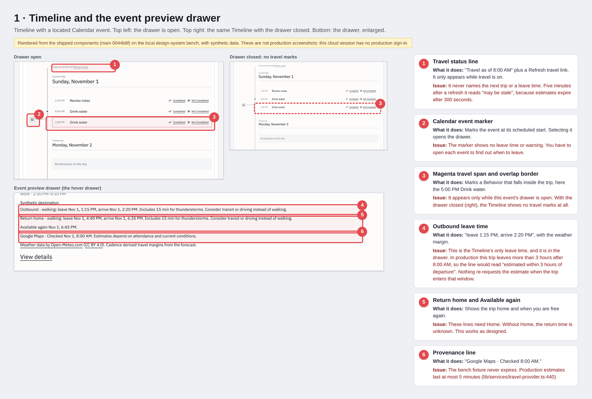
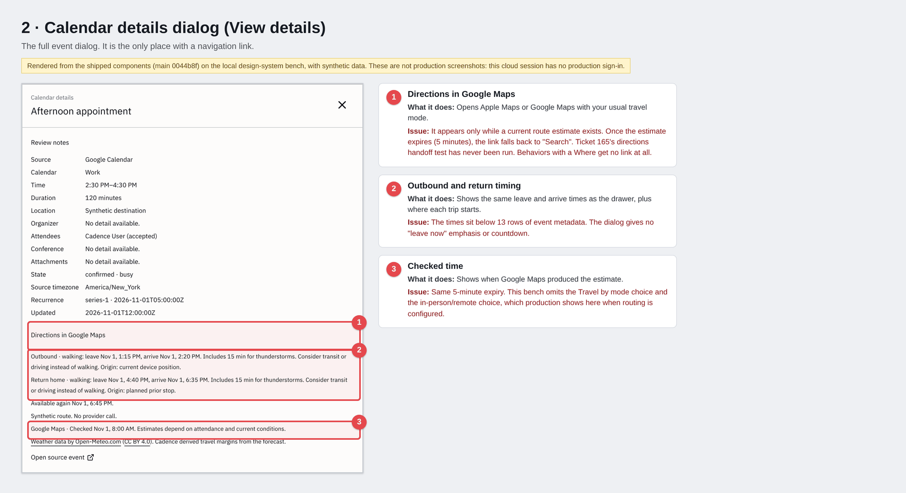
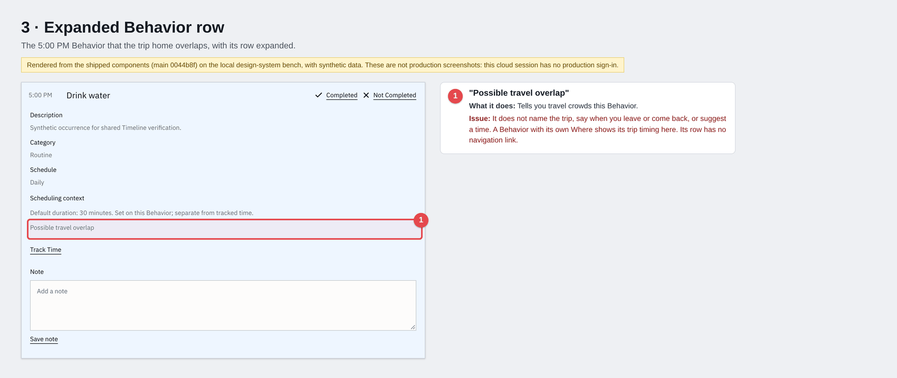
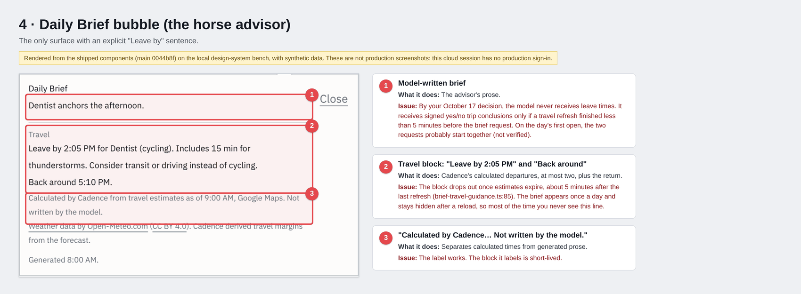
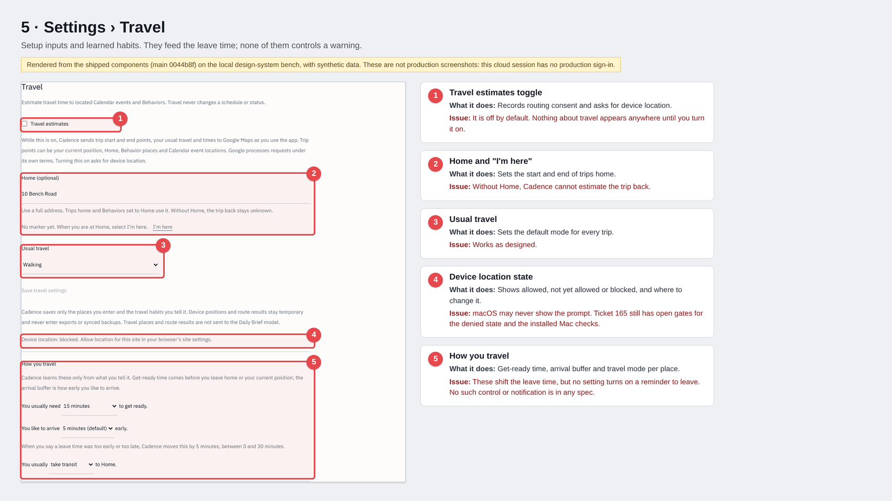
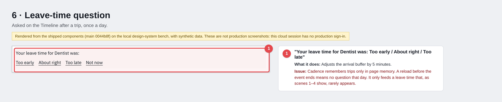
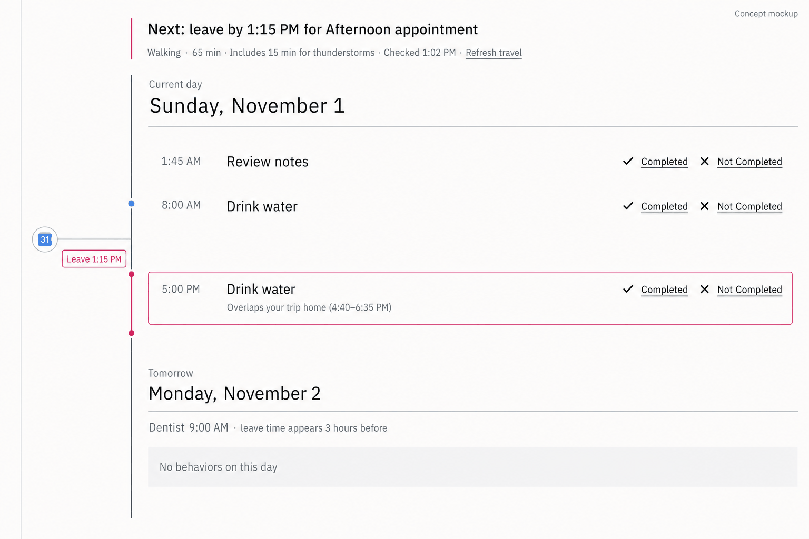
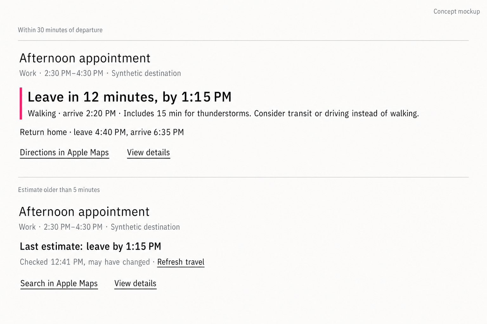
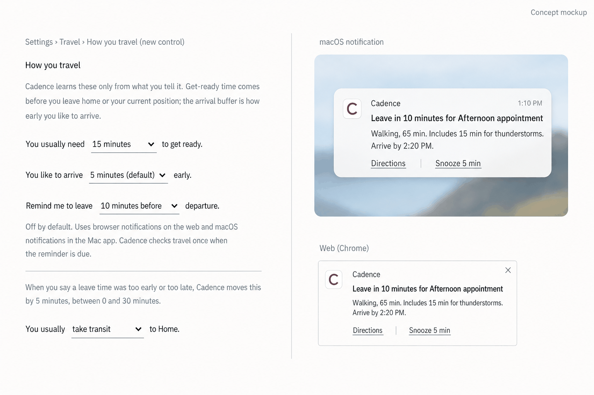
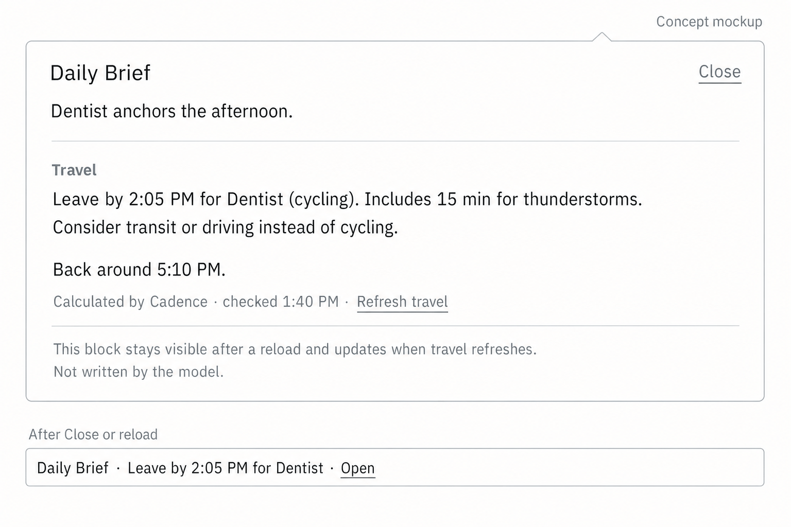

# Travel departure UX review — November 4, 2026

Owner-requested review of the travel feature (Tickets 160–170, 212–219, 243–244).
It records the owner's concerns, the findings from code and documents, a visual
inventory of the current UI and concept mockups of proposed changes. It changes no
runtime behavior, schema, ticket state or user-facing text.

## Summary

Travel routing is live on web. The owner's goal is a clear warning of when to leave.
Cadence does not meet that goal today:

- Leave times exist, but only in places you must open: the event drawer, the event
  dialog and the Daily Brief bubble.
- Two rules hide most leave times most of the day. Estimates expire after 5 minutes
  (Rule 1), and Cadence only estimates trips that leave within 3 hours (Rule 2).
- No spec or ticket includes a warning or notification to leave.
- The model never receives leave times. This follows the owner's October 17 decision.
- The travel text carries too much metadata and internal wording for a launch product.

Evidence: main `0044b8f`, read November 4, 2026. No production data was read. The
screenshots come from the local design-system bench (see "Method and limits").

## Owner concerns

1. **Too much metadata.** The event dialog and travel lines show too many labels. This
   must be fixed in the launch product. Some text is internal and belongs only in
   development, for example "Synthetic route. No provider call.". The owner also
   regards the weather mode advice ("Consider transit or driving instead of walking.")
   as useless text.
2. **Rigid language.** Labels such as "Outbound" should become plain phrases such as
   "Leave by".
3. **Rules 1 and 2.** The owner is concerned that the 5-minute expiry and the 3-hour
   window keep the feature from working. Both rules are described below.

## Where development stands

| Ticket | Scope | State |
|---|---|---|
| 160 | Discovery and design | Done, September 21 |
| 162–164 | Places, routing, Timeline display | Live since September 22 |
| 166–167 | Quota and refresh rules | Superseded by 213–214 |
| 170 | Calculated travel beside the Daily Brief | Built September 26; model projection moved to 219 |
| 213–214 | US$5 monthly budget, change-driven refresh, 3-hour window | Done, October 18 |
| 215 | Three-input Travel Settings, Behavior Where | Live, October 23 |
| 212, 216, 217 | Setup row, completion places, learned habits | Live on web, October 24 |
| 218 | Weather margin | Code live; weather off in production (no `CADENCE_WEATHER_PROVIDER_CLEARANCE`, checked October 27) |
| 219 | Travel facts in Daily Brief model input | Stages 1–2 live; Google support case 76805292 open |
| 165 | Release acceptance | In progress. Open: denied state, installed Mac checks, directions handoff matrix (never run) |
| 243, 244 | Six-leg speed; place data in Full JSON | Backlog |

No travel source has changed since October 25. Privacy entries P-001 to P-004 and
P-012 remain open on the messaging track.

## The two rules

### Rule 1: estimates expire after 5 minutes

In production, a Google Maps estimate is current for at most 300 seconds.
`boundedExpiry` in `lib/services/travel-provider.ts:440` caps it. After that,
Cadence stops treating the estimate as current:

- The Daily Brief's "Leave by" lines disappear. `projectBriefTravelGuidance` drops
  expired legs (`packages/core/src/services/brief-travel-guidance.ts:85`).
- The Directions link falls back to "Search" (`docs/qa/travel-release.md`, directions
  handoff plan, negative checks).
- The Timeline status line reads "Travel estimates from 8:00 AM may be stale."
  (`components/timeline/DayProgressTimeline.tsx:728`).
- The signed trip conclusions for the Daily Brief model expire at the same time
  (`lib/ui/travel.ts:173`).

Why the rule exists: Cadence chose 5 minutes as a conservative reading of Google's
caching terms (`docs/COSTS.md`). Changing it is a product decision. The terms
question is logged in `docs/LEGAL.md` as L-014 and does not hold this work.

The test page hides this rule. It freezes its clock at 8:00 AM, and its Timeline
status view expires in the year 2999 (`app/design-system/CalendarBench.tsx`). The
leave times in the screenshots never go stale or disappear. The Daily Brief guidance
tests also use a 2.5-hour expiry (`tests/brief-travel-guidance.test.ts`). A search
found no test that renders travel UI under the 5-minute cap. The search was not
exhaustive.

### Rule 2: Cadence only estimates trips within the next 3 hours

A Timeline refresh routes only legs that leave, or must arrive, within 3 hours
(`TRAVEL_ROUTE_WINDOW_SECONDS` in `packages/core/src/services/travel-refresh-policy.ts`).
For any later trip, Cadence does not ask Google at all. The trip shows "estimated
within 3 hours of departure" instead of a time.

Ticket 214 set this rule to control cost under the US$5 monthly ceiling. A generated
Daily Brief routes the whole day once, but Rule 1 expires those estimates 5 minutes
later.

Nothing re-requests an estimate when a trip enters the 3-hour window. Estimates
refresh only when the Timeline opens without a current estimate, a source changes,
the device moves more than 500 m, or the user chooses Refresh travel. A user who
checks the Timeline at 8:00 AM sees no leave time for a 4:00 PM event, and may see
none later unless they reopen the Timeline.

The test page does not apply this rule. It builds evidence directly with the travel
resolver. At its 8:00 AM clock it shows a 1:15 PM leave time, which production
would not show.

## How the feature presents travel today

Ticket 164 ruled out a separate travel lane or warning panel. Travel appears on
existing surfaces:

1. **Timeline status line:** "Travel as of 8:00 AM" with Refresh travel.
2. **Event marker and magenta span:** the span and the overlap border on crowded
   Behaviors appear only while that event's drawer is open.
3. **Event preview drawer:** "Outbound · walking: leave Nov 1, 1:15 PM, arrive Nov 1,
   2:20 PM." This is the Timeline's only leave time.
4. **Calendar details dialog:** the same lines below 13 metadata rows, plus the only
   navigation link.
5. **Expanded Behavior row:** "Possible travel overlap", with no trip or time named.
   A Behavior with its own Where shows its trip timing and no navigation link.
6. **Daily Brief bubble:** "Leave by 2:05 PM for Dentist (cycling)." This is the only
   "Leave by" sentence. The bubble appears once a day and stays hidden after a reload
   (`components/briefing/DailyBriefLauncher.tsx`, `marker.delivered`).
7. **Leave-time question:** asked once a day after a trip. Trips live in page memory,
   so a reload before the event ends skips the question.

### The advisor

The model never receives leave times (`docs/DECISIONS.md`, 2026-10-17). It receives
slow-changing facts and signed yes/no trip conclusions. The conclusions reach the
model only if a travel refresh finished less than 5 minutes before the brief request.
On the first open of the day, the brief and the first travel refresh probably start
together. That ordering is not verified.

## Copy and metadata inventory

Sources: `components/timeline/ExternalEventDetails.tsx`,
`components/timeline/TravelWeather.tsx` and
`components/briefing/DailyBriefBubble.tsx`. "Proposed" is a starting point for the
owner's decision, not an agreed change.

### Travel lines

| Current text | Where | Problem | Proposed |
|---|---|---|---|
| "Outbound · walking: leave Nov 1, 1:15 PM, arrive Nov 1, 2:20 PM." | Drawer, dialog | Rigid role label; the date repeats on a same-day trip; lowercase mode | "Leave by 1:15 PM · walking, arrive 2:20 PM" |
| "Return home · walking: leave …, arrive …" | Drawer, dialog | Same pattern | "Head home 4:40 PM · home by 6:35 PM" |
| "Onward · …" | Drawer, dialog | Internal term | "Then leave by …" |
| "Origin: current device position." / "planned prior stop" / "journey correction" | Dialog | Internal provenance terms | Remove, or show only when the start is unusual ("from Home") |
| "Includes 15 min for thunderstorms. Consider transit or driving instead of walking." | Drawer, dialog, bubble | The owner considers the advice useless. It repeats on every leg. Ticket 218 specifies it. | Keep the margin once: "15 min added for thunderstorms". The owner decides on the mode advice. |
| "Available again Nov 1, 6:45 PM." | Drawer, dialog | Acceptable; the date repeats | "Free again 6:45 PM" |
| "Full-trip availability is unknown. Known travel spans still apply." | Drawer, dialog | Internal wording | "Return time unknown. Add Home in Settings to estimate it." |
| "Google Maps · Checked Nov 1, 8:00 AM. Estimates depend on attendance and current conditions." | Drawer, dialog | The disclaimer adds nothing | "Google Maps · checked 8:00 AM". Keep the attribution. |
| "Weather data by Open-Meteo.com (CC BY 4.0). Cadence derived travel margins from the forecast." | Drawer, dialog, bubble | The second sentence is internal | Keep the credit; drop the second sentence. |
| Route warnings, shown verbatim | Dialog | See below | Show only warnings a user can act on |
| "estimated within 3 hours of departure" | Drawer, dialog | Rule 2 wording | "Leave time appears at 1:00 PM" |
| "timing unavailable" | Drawer, dialog | Gives no reason or next step | Name the reason and offer Refresh travel |
| "Possible travel overlap" | Expanded row | Names no trip or time | "Overlaps your trip home (4:40–6:35 PM)" |
| "Calculated by Cadence from travel estimates as of 9:00 AM, Google Maps. Not written by the model." | Bubble | Long | "Calculated by Cadence · Google Maps · 9:00 AM" |

**Route warnings.** The dialog prints every string in `estimate.warnings`
(`ExternalEventDetails.tsx`, `renderTravelTiming`). In production these are Google's
route warnings, up to 10 per leg, plus Cadence's "Estimated arrival is after the
planned arrival time.". "Synthetic route. No provider call." comes from the bench
fixture (`app/design-system/TravelBench.tsx:107`). It cannot reach production because
the bench route is disabled in production builds. The display path is the same,
though, so production prints Google's warnings verbatim. Mark fixture text as
development-only so nobody mistakes it for product copy. The terms question about
hiding Google's warnings is logged in `docs/LEGAL.md` as L-013 and does not hold the
copy work.

### Event dialog metadata rows

The dialog shows 13 rows before any travel line: Source, Calendar, Time, Duration,
Location, Organizer, Attendees, Conference, Attachments, State, Source timezone,
Recurrence and Updated.

- Empty fields repeat "No detail available." (Organizer, Conference, Attachments).
- State shows raw provider values: "confirmed · busy".
- Source timezone shows an IANA name: "America/New_York".
- Recurrence shows an internal series ID and an ISO instant:
  "series-1 · 2026-11-01T05:00:00Z".
- Updated shows a raw ISO instant: "2026-11-01T12:00:00Z".

Proposed: show Time, Location and the travel lines first. Hide empty rows. Move
State, Source timezone, Recurrence and Updated behind a "More details" disclosure, or
limit them to development builds. Format every time in the account timezone.

## Visual inventory

These images come from the shipped components on the local design-system bench, with
synthetic data. They are not production screenshots. Numbered boxes mark each element,
and the side panel states what it does and what is wrong with it.

## Proposals

The mockups are generated concept images (OpenAI `gpt-image-2`, with the bench
screenshots as style references). They show direction, not final copy or layout.
Some generated times do not agree with each other. Read them as placeholders.
Provider-terms questions from this review are logged in `docs/LEGAL.md` (L-013, L-014).
Under the 2026-11-04 decision they do not hold any proposal.

### P1: Next departure on the Timeline

A persistent line at the top of the Timeline: "Next: leave by 1:15 PM for Afternoon
appointment", with mode, duration, margin, check time and Refresh travel. A "Leave
1:15 PM" label sits on the event marker. The travel span stays visible with the drawer
closed. Later trips show when their leave time will appear.

### P2: "Leave now" emphasis and a stale-estimate fallback in the drawer

Within 30 minutes of departure: "Leave in 12 minutes, by 1:15 PM". After expiry:
"Last estimate: leave by 1:15 PM · Checked 12:41 PM, may have changed · Refresh
travel" instead of no time.

### P3: Optional leave reminder

A new sentence in How you travel: "Remind me to leave [10 minutes before]
departure.", off by default. Delivery uses browser push on web and native
notifications on the Mac. This is new scope. It needs a `docs/NOTIFICATION_SPEC.md`
change and a fresh route request when the reminder is due.

### P4: Daily Brief travel block that persists

The travel block survives a reload and updates when travel refreshes. After Close,
the bubble collapses to one line: "Daily Brief · Leave by 2:05 PM for Dentist ·
Open".

### Not visual

- **Refresh at the window boundary.** Request routes once when a trip enters the
  3-hour window while the Timeline is open. This spends budget; measure against the
  US$5 ceiling in `docs/COSTS.md`.
- **Development-only text.** Label fixture strings in bench data and keep them out of
  product copy paths.

## Decisions for the owner

1. Approve the copy direction: plain "Leave by" phrasing, and the metadata reductions
   above, before launch.
2. Keep or remove the weather mode advice ("Consider transit or driving instead of
   …"). Ticket 218 specifies it today.
3. Rule 1: allow a last-known leave time after 5 minutes, marked as a last estimate
   (P2, P4).
4. Rule 2: allow one automatic refresh when a trip enters the 3-hour window.
5. P3: add the optional leave reminder to scope.
6. Run the Ticket 165 directions handoff matrix under a spend cap.

## Candidate follow-up tickets

The copy and metadata pass is filed as Tickets 260–262 (`docs/TICKETS.md`), with
messaging entry P-015. The other candidates are not filed. Each one, when filed, needs
its own platform-impact table and messaging entry. Copy changes alter `docs/user-guide/travel.md` and in-app text, so
each one logs a `docs/MESSAGING_CHANGES.md` entry.

| Candidate | Web | Desktop | Marketing | Future mobile |
|---|---|---|---|---|
| Travel copy and metadata pass (Tickets 260–262) | `ExternalEventDetails`, `TravelWeather`, `DailyBriefBubble` | Same shared components | User guide wording only | Shared components; 390 px check |
| Next-departure line (P1) | `DayProgressTimeline` status line | Shared Timeline | None until released | Mobile web inherits |
| Window-boundary refresh | `lib/ui/travel.ts` | `apps/desktop/src/travel.ts` | None | Not applicable |
| Leave reminder (P3) | Web Push and `docs/NOTIFICATION_SPEC.md` | Native notifications | Messaging entry | Deferred with native mobile |
| Stale fallback (P2, P4) | Drawer and bubble | Shared | Messaging entry | Mobile web inherits |
| Bench and tests reflect Rules 1 and 2 | `app/design-system/CalendarBench.tsx`, resolver tests | Shared core tests | Not applicable | Not applicable |

## Method and limits

- This cloud session had no production sign-in. The QA sessions live in the owner's
  Mac Keychain, and no Mac folder was shared with the session. All screenshots come
  from `/design-system` on a local `next dev`, using bench fixtures.
- The bench shows the best case. Its clock is frozen, its estimates never expire, and
  it ignores the 3-hour window. It also omits the Travel by mode choice and the
  in-person/remote correction that production shows in the dialog.
- Not verified: whether the drawer and dialog lines change after expiry, or keep
  showing the last times; the order of the first brief and travel requests; any
  production state after October 27.
- The mockups are generated images and contain placeholder times.
